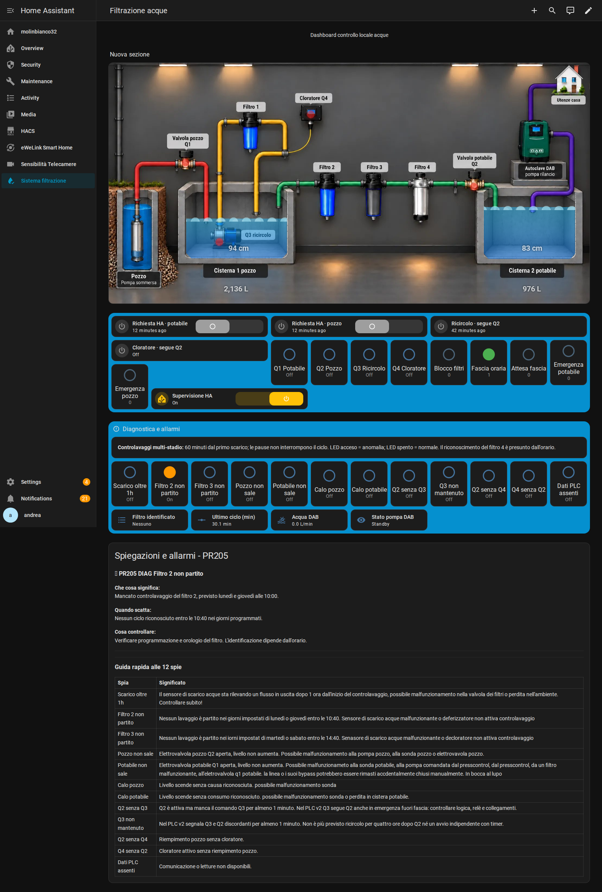

# Filtrazione acque — PLC autonomo e supervisione HA

Aggiornamento 29 ottobre 2026. [Apri la plancia locale](http://192.168.0.124/sistema-filtrazione-v2/filtrazione-acque).

## Configurazione pubblicata

La voce laterale **Sistema filtrazione** apre la nuova plancia. Il collegamento dalla dashboard di casa è stato aggiornato. La vista originale `dashboard-casa/filtrazione-acque` è conservata con `visible: false`; anche la vecchia dashboard separata è nascosta dalla barra laterale. Sono modifiche di navigazione, non restrizioni di accesso.

La copia deriva dalla vista online indicata dall’utente: 76 schede e 20 elementi sullo schema. File corrente in `dashboard/plancia.json`. Moduli e risorse in `www/` e `dashboard/risorse-lovelace.json`; immagini e GIF già presenti sull’istanza restano necessarie. Non sostituire in blocco le risorse globali.

## File e ripristino

- `packages/filtrazione_v2.yaml`: presenza HA, rilascio, richieste protette, adattatori interruttori e percentuali.
- `packages/pr205_diagnostica.yaml`: diagnostica compatibile con Q3 e Q4 solidali a Q2.
- `configuration-frammento.yaml`: estratto Modbus PR205 e template interessati; integrare nei blocchi esistenti, **non sostituire l’intera configurazione**.
- `archivio/automazioni-precedenti-disabilitate.yaml`: sei vecchie automazioni con avvio disabilitato. Non riattivarle insieme al protocollo v2.

Le automazioni e gli script della casa estranei al lavoro non vengono inclusi. Nessun token, segreto, database, backup completo o archivio di autenticazione è pubblicato.

## Supervisione Home Assistant

Il tasto `input_boolean.filtrazione_v2_supervisione` abilita il segnale di presenza: alternanza 0/1 ogni 10 secondi. Da solo non avvia riempimenti. A PLC online sono disponibili richieste potabile e pozzo, anche fuori 11–15, sempre soggette alle protezioni PLC.

Spegnendolo HA cancella gli avvii pendenti, azzera le richieste se la PLC è raggiungibile e smette il segnale. Sensori e autonomia PLC restano attivi. Se HA/rete cade, dopo 45 secondi senza alternanza la PLC scarta le richieste HA: un ciclo sostenuto soltanto da HA può fermarsi, mentre la logica nativa continua secondo le proprie condizioni. Non è un arresto generale.

## Regole PLC

Richieste native: potabile <30 cm e pozzo <60 cm per 50 secondi. Emergenze 20/50 cm; conservato il consenso temporizzato della richiesta nativa. Massimi inclusivi 115/160 cm applicati anche a HA/manuale. Percentuali 110/160 cm, visualizzazione limitata al 100%. Q3 e Q4 seguono Q2. Filtri obbligatori per Q1; priorità e interblocco restano nella PLC.

[Progetto PLC v2.0.1](https://github.com/puzzalela416/test/tree/codex-cisterne-potabile40-20261022/plc/filtrazione-v2).

## Verifiche e attività aperte

Plancia verificata nel browser: due livelli animati, nessuna scheda in errore, nessun errore JavaScript. Nessun comando di avvio impianto inviato durante la pubblicazione. Il progetto è stato caricato dall’utente e il protocollo 2 è stato letto dalla PLC. Restano da completare il collaudo idraulico, la strategia fotovoltaico/consumi e il ruolo DAB: non sono già implementati dal tasto supervisione.

I due backup completi dell’intervento `PRIMA.zip` e `DOPO.zip` restano sul dispositivo in `/home/dedroid/ottimizzazione-automazioni-ha/backup-corrente/`.
