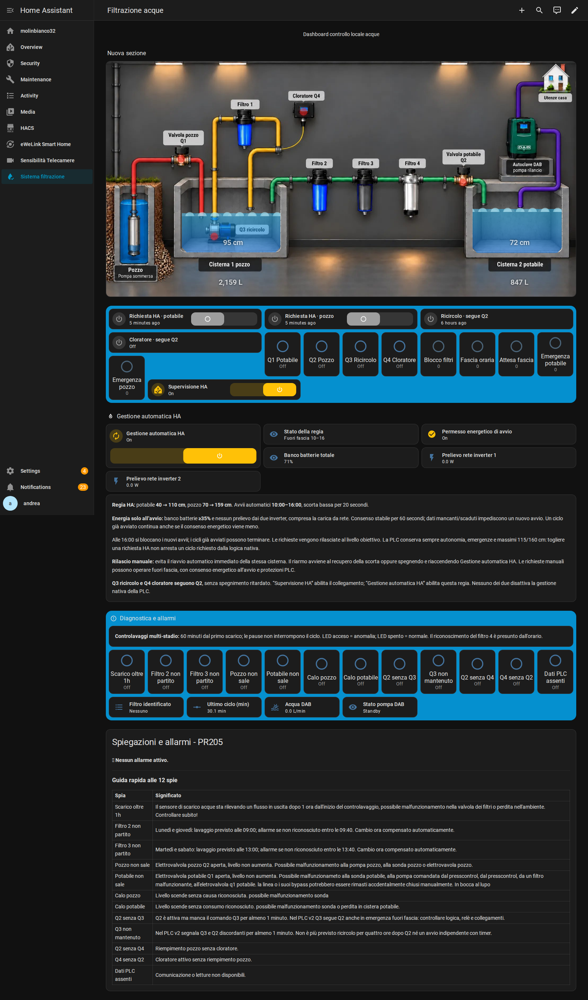

# Regia centrale filtrazione — 2026-10-29_191041_regia-comando

[Plancia locale](http://192.168.0.124/sistema-filtrazione-v2/filtrazione-acque) · [Censimento](CENSIMENTO.md)

## Regole concordate

| Funzione | Potabile | Pozzo |
|---|---|---|
| Avvio HA sotto | 40 cm | 70 cm |
| Obiettivo di rilascio HA | 110 cm incluso | 159 cm incluso |
| Avvio nativo PLC | 30 cm | 60 cm |
| Massimo inderogabile PLC | 115 cm | 160 cm |

Nuovi avvii automatici dalle **10:00 incluse alle 16:00 escluse**. Alle 16 i cicli già iniziati possono terminare; il criterio preserva il comportamento delle automazioni originali. Scorta bassa stabile 20 secondi per evitare transitori. Ricircolo Q3 e cloratore Q4 seguono Q2 nel PLC, senza ritardo di spegnimento.

**Energia controllata soltanto all’avvio**, come richiesto: `sensor.jk_banco_soc` >=35%, entrambi gli ingressi rete Growatt <=0 W e nessuna carica batterie da rete. Ogni inverter viene valutato separatamente: non si compensano importazioni con esportazioni. Nessuna tolleranza nascosta di 20 W. Permesso stabile 60 secondi; dati sconosciuti/non numerici o scaduti impediscono un nuovo avvio. Controllati anche i dati batteria che alimentano il SOC aggregato per evitare un totale apparentemente valido con un pacco mancante. Le misure dinamiche di energia devono essere aggiornate entro 120 secondi.

Un ciclo avviato **non viene interrotto perché il SOC scende o compare un prelievo dalla rete**. Restano attivi arresto al livello obiettivo, filtri per Q1, priorità dell’emergenza potabile per Q2, rilascio manuale, disabilitazione della supervisione e gestione dei dati PLC mancanti. Disabilitare Gestione automatica rilascia le sue richieste; non disabilita la PLC.

## Comandi e riavvii

“Supervisione HA” abilita heartbeat e collegamento. “Gestione automatica HA” abilita il coordinatore. Sono entrambi **ON** a fine intervento; stato attuale fuori fascia. Il coordinatore rivaluta ogni 15 secondi e sulle variazioni rilevanti, quindi riconosce anche livelli già bassi all’ingresso in fascia o dopo un riavvio.

Tra due nuove richieste ordinarie contemporanee si sceglie il pozzo; non si avvia un secondo ciclo HA mentre uno è già richiesto/in corso. La PLC conserva arbitraggio finale, autonomia ed emergenze. Il rilascio di una richiesta HA non arresta un ciclo che la PLC richiede autonomamente: quel ciclo segue le proprie regole fino al suo massimo.

I quattro script restano i punti di comando protetti. L’origine manuale/automatica distingue proprietà del ciclo e rilascio; un rilascio manuale impedisce il riavvio automatico immediato della stessa cisterna. Il riarmo avviene quando la scorta recupera la soglia oppure spegnendo/riaccendendo Gestione automatica. Richieste manuali possibili fuori fascia, con consenso energetico all’avvio e protezioni valide. Nessun ritorno al vecchio Manuale HA globale.

## File e organizzazione

- `packages/filtrazione_v2.yaml`: regia, quattro script, presenza/rilascio, permessi, stato e adattatori della plancia.
- `packages/pr205_diagnostica.yaml`: dodici diagnostiche e tre automazioni di memoria/controlavaggio; calendario UTC+02 dei timer già corretto.
- `configuration-frammento.yaml`: solo estratto PR205 e template coinvolti; integrare nei blocchi esistenti, **non sostituire l’intero configuration.yaml**. Letture livelli passate a 5 secondi. DAB flusso non disponibile rimane non disponibile invece di diventare falso.
- `archivio/automazioni-precedenti-disabilitate.yaml`: sei vecchie automazioni conservate con `initial_state: false`; nessuna vecchia scrittura deve tornare attiva.
- `dashboard/plancia.json`: vista aggiornata con stato regia, SOC e permesso energetico.
- `docs/`: screenshot e risultati delle verifiche.

Questa cartella è una versione aggiunta senza sovrascrivere quelle precedenti. Database, credenziali, backup completi e automazioni estranee non sono pubblicati.

## Verifiche effettive

182 scenari del pianificatore e 46 energetici eseguiti nel motore del vero HA; controllati anche i tipi nativi numerici di HA e la prosecuzione dei cicli dopo perdita del consenso energetico/fine fascia. Configurazione verificata dal server e ricaricata senza riavvio.

Regia installata ed eseguita realmente fuori fascia; entrambi gli script automatici chiamati e bloccati dalle condizioni senza generare richieste ON. Consenso energetico osservato dai sensori reali. Watchdog PLC verificato in precedenza interrompendo il heartbeat e osservando HA online scadere e tornare dopo il ripristino. Dodici diagnostiche verificate in 40 scenari isolati, senza falsificare entità di produzione. Calendario stagionale verificato in 441 scenari.

Nessuna prova ha avviato pompe o riempimenti. **Collaudo fisico e cicli completi restano da eseguire con sorveglianza sul posto.** Lo stato del comando PLC non certifica il movimento meccanico di una valvola o la marcia di una pompa.
