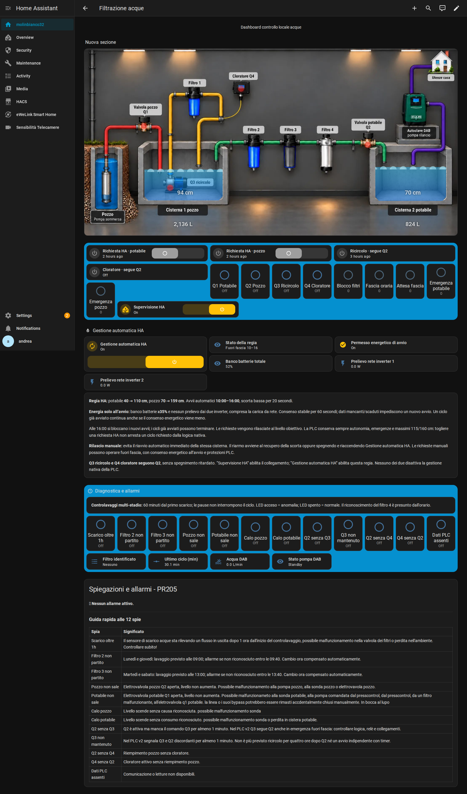

# Filtrazione come sottovista Proprietà — 2026-10-30_003025_navigazione-proprieta

Percorso operativo: **[Proprietà](http://192.168.0.124/dashboard-casa/proprieta) → clic sul PNG trasparente dell’impianto → [Filtrazione acque](http://192.168.0.124/dashboard-casa/filtrazione-acque)**.

## Correzione

Le due viste aggiornate erano identiche, ma il PNG in Proprietà puntava ancora alla dashboard separata `/sistema-filtrazione-v2/filtrazione-acque`. Ora punta alla sottovista `/dashboard-casa/filtrazione-acque`, già presente nella dashboard di casa, con `subview: true` e `back_path: /dashboard-casa/proprieta`.

La dashboard separata v2 è nascosta dalla barra laterale e rinominata “Sistema filtrazione — archivio v2”. La vecchia dashboard separata era già nascosta. Restano conservate e accessibili dai rispettivi URL come archivi; nella navigazione normale rimane la sottovista della casa. Nascondere una dashboard non è una restrizione di accesso.

Nessun cambiamento al contenuto della plancia, alle immagini, alle altre viste, alle automazioni, al PLC o agli script. Nessun comando dell’impianto inviato.

## Verifiche

Clic reale sul PNG nel browser: dimensioni dell’area cliccabile 100×100, destinazione corretta `/dashboard-casa/filtrazione-acque`. Due livelli animati caricati, zero schede in errore, zero errori JavaScript e zero voci laterali delle dashboard filtrazione. Verificato il ritorno a Proprietà dalla cronologia; il percorso di ritorno della sottovista è verificato nella configurazione.

## File

- `PATCH-NAVIGAZIONE.json`: cambiamento puntuale del collegamento e metadati sidebar.
- `VISTA-FILTRAZIONE.json`: contenuto della sottovista, invariato.
- `VERIFICA-HA.json` e `VERIFICA-BROWSER.json`: riscontri sul server e nel browser.

I backup completi di prima/dopo, inclusa la dashboard di casa intera, restano sul PC. Non vengono pubblicate le altre viste della casa o la mappa completa della proprietà. Questa è una nuova versione: nessun file GitHub precedente sovrascritto o cancellato.
