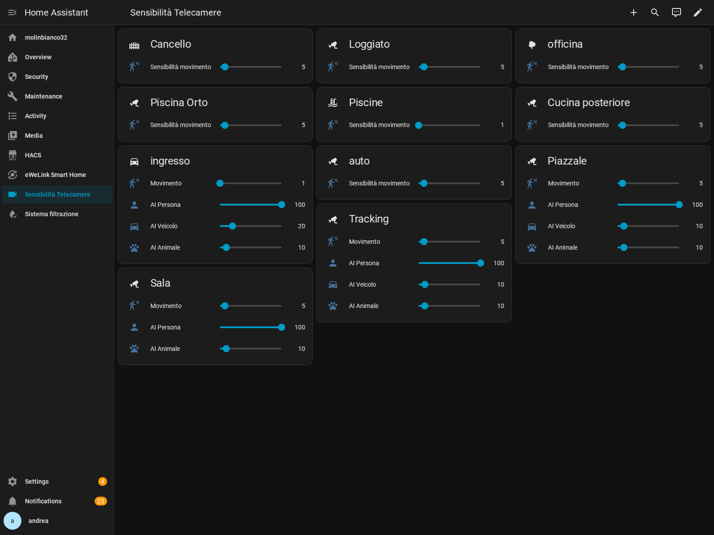

# Telecamere e fotocellule — 2026-10-29_203022_telecamere-fotocellule-v1

[Censimento dettagliato](CENSIMENTO.md) · [Plancia locale](http://192.168.0.124/sensibilita-telecamere/sensibilita-telecamere)

## Una sola regolazione della sensibilità

`Telecamere - Sensibilità adattiva e profili giorno notte` gestisce **11 telecamere**, ciascuna con il proprio contatore e timer, senza mescolare gli eventi. Dieci cambi ON/OFF in cinque minuti (non dieci persone distinte) chiedono una riduzione di due punti, fino al minimo hardware. Le altre telecamere non vengono modificate da quegli eventi. Notifiche persistenti con un ID per camera evitano l’accumulo di messaggi separati; al minimo viene segnalata l’impossibilità di ridurre ancora.

Alba: sensibilità movimento 42; tramonto: 5. Profili AI già esistenti conservati: persone 100, veicoli 20 giorno/10 notte, animali 10, solo per entità effettivamente presenti. Avvio HA: ripartenza del monitoraggio con finestre pulite, senza azzerare le sensibilità apprese a ogni riavvio. Un dispositivo non disponibile non deve fermare le altre camere.

Il vecchio Parking è un dispositivo disabilitato e non viene riattivato: si usa l’Ingresso corrente. Orto è stato riabilitato e allineato da 37 a 5 nella notte dell’installazione. Gli altri dieci valori sono stati riscritti uguali per verificare realmente i comandi, preservando i minimi 1 già raggiunti da Piscine e Ingresso.

## Quattro fotocellule separate

- Cancello → Giardino.
- Ingresso → Torre ingresso.
- Piscine → Capanno.
- Orto → Torre Orto.

Solo fra tramonto e alba. Il timer di **due minuti parte alla fine del movimento** e viene annullato se il movimento ricompare. Ogni zona ha un timer e una proprietà del comando indipendenti. Luce già accesa da altri comandi: la fotocellula non se ne appropria e non la spegne. Dopo un riavvio riconcilia solo i propri timer/accensioni; allarme prioritario e rilascio della proprietà senza spegnere le luci dell’allarme.

**Parcheggio e Ciabatta volante non sono comandati da movimento.** Parcheggio conserva l’accensione a tramonto +15 minuti. Il Philips usa breve ON/lunga OFF per Torre Orto e Ciabatta; il comando manuale prende priorità sul timer Torre Orto. I faretti Piazzale, Ingresso e Tracking/Giardino restano gestiti dalle telecamere: nessun comando `light.turn_on/off` nel nuovo package.

## Conservazione e scelte esplicite

Nove vecchie definizioni restano nel file principale con `initial_state: false`; nessuna viene cancellata. Le due definizioni Philips e quella Parcheggio vengono corrette mantenendo gli ID. `prima/` conserva le versioni originali pertinenti. **Spegni esterno all’alba resta identica**, per richiesta dell’utente. Anche la sequenza dell’allarme rimane invariata: una proposta aggiuntiva sui suoi bersagli attende risposta.

## File

- `packages/telecamere_fotocellule_v1.yaml`: helper e cinque nuove automazioni.
- `automazioni-principali-aggiornate.yaml`: solo i 14 blocchi esistenti pertinenti, non l’intero file della casa. Integrare per ID, non aggiungere duplicati.
- `prima/`: blocchi originali e plancia originale.
- `dashboard/plancia-sensibilita.json`: sola correzione della scheda Orto.
- `docs/`: prove, mappature e screenshot.

Per installare su un’altra istanza, adattare gli ID reali e attivare il parametro Orto se disabilitato. `input_number`, `input_boolean`, `timer` e automazioni possono essere ricaricati; il ripristino dei file originali richiede anche la disabilitazione del nuovo package, per non avere controllori concorrenti. Gli helper legacy Piscine non vengono eliminati.

## Verifiche reali e limiti

Servizi di sensibilità eseguiti su tutte le 11 camere e valori riletti; dispatcher adattivo realmente eseguito per tutte le 11 finestre, a conteggio zero; quattro timer realmente scaduti dopo 120 secondi senza proprietà delle luci. Verificate 512 combinazioni delle sequenze reali YAML delle fotocellule sul motore template HA, oltre alle mappature e ai limiti numerici. Nessun falso movimento iniettato e nessuna luce accesa artificialmente.

Queste prove verificano i comandi e i percorsi protetti, non la qualità del rilevamento in pioggia/vento o tutte le accensioni fisiche. **La sensibilità minima non garantisce zero falsi eventi:** potrebbero servire maschere, inquadrature o rilevamento persone, da valutare sul campo senza disabilitare silenziosamente gli allarmi.
